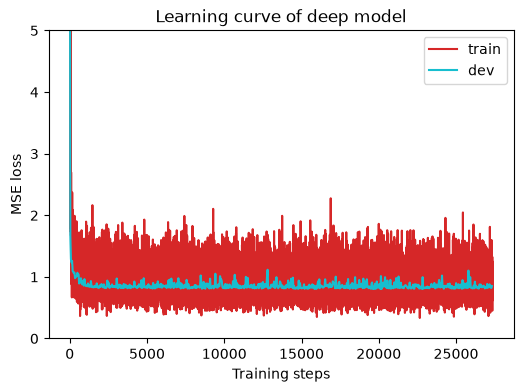
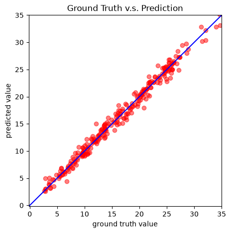

# HW01 — COVID-19 Cases Prediction with PyTorch

> 李宏毅《Machine Learning 2021》Homework 1 · Regression · 个人学习与实验记录

**任务：** 根据美国州别信息及连续三天的疫情相关调查数据，预测第三天的 COVID-19 检测阳性率（`tested_positive`）。  
**技术栈：** Python · PyTorch · NumPy · Matplotlib  
**最佳方案：** 15-dimensional feature selection + train-only Z-score normalization + one-hidden-layer MLP

## 1. 任务与实验思路

本作业属于监督学习中的**回归（Regression）**。输入为每条样本的地区与多日调查特征，输出为第三天的 `tested_positive` 连续数值。原始数据（去除样本 ID 后）包含 93 个可用输入特征；训练文件另有 1 列目标值，测试文件不含目标值。

| 数据 | 数量 | 用途 |
|---|---:|---|
| `covid.train.csv` | 2,700 | 带标签数据 |
| Training subset | 2,430 | 训练模型及拟合标准化参数 |
| Validation subset | 270 | 模型选择与 Early Stopping |
| `covid.test.csv` | 893 | 输出 Kaggle 预测结果 |

保持官方 Notebook 的固定划分规则：索引满足 `i % 10 == 0` 的样本用于 Validation，其余用于 Training。

实验思路不是直接扩大神经网络，而是从官方 Starter Notebook 出发，先建立可运行的基线，再通过**控制变量实验**观察网络结构、学习率、优化器、Batch Size、L2 正则化、特征选择与标准化的影响。最终参考另一份 HW1 实现的 *15 维候选特征思路*，将它迁移至当前 PyTorch 训练流程，并将预处理改为仅用训练子集拟合均值和标准差。

> **来源说明：** 原始数据、任务、训练框架和大部分工具函数来自课程 Starter Notebook；15 维候选特征组合借鉴了学习时参考的同学实现。本文主要记录自己进行的代码调整、实验对照、复现与分析，不将官方代码或参考方案表述为原创。

## 2. 最终模型与训练实现

### 2.1 输入特征：15 维

最终不使用 40 个州 one-hot 特征，改为选取三天的疾病相关指标、前两天的检测阳性率，以及第三天的财务担忧指标。

| 时间 | 原始 CSV 去除 ID 后的特征索引 | 内容 |
|---|---|---|
| Day 1 | `40, 41, 42, 43, 57` | `cli`, `ili`, `hh_cmnty_cli`, `nohh_cmnty_cli`, `tested_positive` |
| Day 2 | `58, 59, 60, 61, 75` | 相同四个疾病相关指标与第二天 `tested_positive` |
| Day 3 | `76, 77, 78, 79, 92` | 相同四个疾病相关指标与 `worried_finances` |

```python
feats = [
    40, 41, 42, 43, 57,
    58, 59, 60, 61, 75,
    76, 77, 78, 79, 92,
]
```

Day 3 的目标 `tested_positive` **不在输入中**。以上 15 个特征在训练和测试 CSV 中均存在。这组特征利用历史阳性率与各天疾病指标来描述疫情水平及其变化；选择它们并不意味着其他变量完全无用，仍需通过进一步的消融实验检验各个子集的边际贡献。

### 2.2 标准化与数据流程

所有 15 个选中变量均为连续数值特征，使用 Z-score 标准化：

\[
x'_j=\frac{x_j-\mu_{\mathrm{train},j}}{\max(\sigma_{\mathrm{train},j},10^{-8})}
\]

**先划分训练/验证，再仅在 Training subset 上计算 `mean/std`**；Validation 和 Test 统一使用 Training 的统计量。这避免了在预处理参数拟合阶段使用验证集或测试集的信息。

实现上，在 `COVID19Dataset` 中增加特征索引和 `norm_stats` 处理，在 `prep_dataloader` 中透传 `norm_stats`，并按照 Train → Dev → Test 顺序初始化数据。最终输入张量形状：`[2430, 15]`、`[270, 15]` 和 `[893, 15]`。

### 2.3 模型结构

采用结构简单的多层感知机（MLP）：

```python
nn.Sequential(
    nn.Linear(15, 64),
    nn.ReLU(),
    nn.Linear(64, 1),
)
```

即 **15 → 64 → 1**，共有 **1,089 个可训练参数**。`forward()` 使用 `squeeze(1)` 返回一维回归预测值。没有额外的输出激活函数。

### 2.4 Loss、Optimizer 与训练设置

损失函数为 **MSE（均方误差）**：

\[
\mathrm{MSE}=\frac{1}{N}\sum_{i=1}^{N}(\hat y_i-y_i)^2
\]

最终使用 **SGD + Momentum** 优化，通过 `weight_decay=0.01` 实施 L2 风格的参数约束；`cal_loss()` 本身仅计算 MSE，没有额外手动叠加 L1/L2 项。

| 超参数 / 模块 | 最终设置 |
|---|---|
| Input features | 15 |
| Network | `15 → 64 → ReLU → 1` |
| Loss | `nn.MSELoss(reduction='mean')` |
| Optimizer | SGD |
| Learning rate | `0.001` |
| Momentum | `0.9` |
| Weight decay | `0.01` |
| Batch size | `64` |
| Normalization | Train-only Z-score（15 列全部标准化） |
| Maximum epochs | `3000` |
| Early stopping | 连续超过 200 个 epoch 未刷新最佳 Dev MSE 时停止 |
| Random seed | `42069` |
| Best checkpoint | `models/model_15features.pth` |
| Predictions | `pred_15features.csv` |

每个 batch 执行清零梯度 → Forward → MSE → Backward → `optimizer.step()`；每个 epoch 评估 Dev MSE，仅在表现改善时保存模型。最终 **Best Epoch = 519，Stop Epoch = 720**，预测时重新载入第 519 轮保存的权重。

**实际改动：** 调整了 Dataset 的特征选择与标准化逻辑、DataLoader 的参数传递、超参数配置与模型保存路径、Train/Dev/Test 数据初始化顺序，以及预测结果文件名。`NeuralNet` 的基本层结构、训练循环、验证函数、预测函数及绘图工具沿用课程框架，并通过实验理解和复用。

## 3. 实验结果

### 3.1 最佳模型

本地训练采用 **MSE**；Kaggle 使用 **RMSE**。只有先对本地 MSE 开平方，才能比较指标的量纲；不同数据划分上的分数仍不能视作等价。

| 指标 | 最终 F15 结果 |
|---|---:|
| Best Validation MSE | **0.8037** |
| Validation RMSE（由 MSE 换算） | **≈ 0.8965** |
| Kaggle Public RMSE | **0.89720** |
| Kaggle Private RMSE | **0.89980** |
| Best / Stop epoch | **519 / 720** |

Kaggle Public、Private 与本地验证的 RMSE 非常接近，说明此次固定验证集对该模型的测试表现给出了较一致的估计；但一次划分仍不能证明模型在其他数据分布上必然稳定。

课程给出的 Strong Baseline 参考值约为 **0.88017**；本次模型**明显优于先前自己的 Strong1，但尚未达到该参考线**。

### 3.2 Training / Validation Loss 曲线



**图 1：** 最终 Notebook 的真实训练记录。红线为每个 mini-batch 的 Training MSE，蓝线为每个 epoch 的 Validation MSE；因此训练曲线呈现明显的 batch 级波动，两条线的采样频率不同，不能简单按瞬时点逐一比较。两者在训练初期快速下降，Validation MSE 随后缓慢改进，在第 519 轮达到最佳约 **0.8037**，之后因 Early Stopping 在第 720 轮结束。图的纵轴限定在 0～5，较高的初始损失未完全显示。

### 3.3 验证集预测结果



**图 2：** 横轴为真实阳性率，纵轴为预测阳性率，蓝线为理想的 `prediction = ground truth`。多数点分布在参考线附近，但仍存在离散偏差；原绘图将坐标轴限制在 0～35，不能据此声称超出该范围的预测同样准确。

### 3.4 与先前模型对比

| 实验版本 | 输入特征 | 标准化 | Dev MSE | Public RMSE | Private RMSE |
|---|---:|---|---:|---:|---:|
| Strong1 / N1 | 42 | 无 | 0.929057 | 0.95505 | 0.95730 |
| Strong2 / F4 | 93 | 原始分数据集标准化 | **0.714680** | 1.48292 | 1.53678 |
| F4 Train-only | 93 | Train-only | 0.716662 | — | — |
| **F15（最终）** | **15** | **Train-only** | **0.8037** | **0.89720** | **0.89980** |

相较自己的 Strong1，F15 的 **Public RMSE 降低约 6.1%，Private RMSE 降低约 6.0%**。然而，因为 F15 同时修改了特征集合及标准化处理，现有结果尚无法将改善完全归因于某一项改动。

## 4. 实验过程与问题分析

以下各组数据来自此前分阶段进行的控制变量实验；由于超参数和特征集合的基准配置在不同阶段有所区别，**不能直接把不同小表中的最优值当成同一次严格的联合消融实验**。

### 4.1 网络深度与宽度

| 网络 | Dev MSE |
|---|---:|
| `42 → 64 → 1` | **0.9614** |
| `42 → 64 → 32 → 1` | 0.9744 |
| `42 → 128 → 64 → 1` | 0.9831 |

加深或加宽网络并未改善验证表现。对于当前小样本回归任务，简单网络已具有一定表达能力，增加参数量未必有益。因此最终保留单隐藏层，而将改进重点转向数据表示。

### 4.2 Learning Rate 与 Optimizer

| Learning rate（SGD） | Dev MSE |
|---|---:|
| `0.0003` | 0.9630 |
| **`0.001`** | **0.9614** |
| `0.003` | 0.9628 |

| Optimizer（各自试验配置） | Dev MSE |
|---|---:|
| **SGD + Momentum** | **0.9614** |
| Adam | 0.9935 |
| Adagrad | 1.0068 |

改变学习率并未带来显著精度提升；Adam、Adagrad 在当时的试验配置下没有优于 SGD。它们不是“普遍更差”，只是当前设置未取得更好结果。

### 4.3 Batch Size 与 L2 Regularization

| Batch size | Dev MSE |
|---|---:|
| 270 | 0.9614 |
| 128 | 0.9587 |
| **64** | **0.9578** |

适当减小 Batch Size 有小幅收益；但不同 Batch Size 会改变每个 epoch 的更新次数，因此不能将变化完全归因于梯度噪声。

| Weight decay（Batch=64 阶段） | Dev MSE |
|---|---:|
| 0 | 0.9578 |
| 0.0001 | 0.9577 |
| 0.001 | 0.9573 |
| **0.01** | **0.9543** |
| 0.1 | 0.9781 |

适量正则化有帮助，过强正则化会使性能下降，因此最终沿用 `weight_decay=0.01`。

### 4.4 最有启发的问题：标准化、特征冗余与泛化

早期 42 维模型仅包含 40 个州 one-hot 特征和两个同类型阳性率特征，不做标准化时反而表现更好；但扩展至更多不同量纲的连续调查特征时，不标准化可能造成严重优化困难，例如 93 维无标准化实验的 Dev MSE 达到约 **58.94**。

更值得警惕的是，93 维模型在本地 Dev 上取得约 **0.71468 MSE**，却在 Kaggle 上得到约 **1.48/1.54 RMSE**，远差于 42 维模型。这提示：**更低的单次 Validation Loss 不保证更好的隐藏测试集表现**。可能因素包括验证集与测试集的分布差异、冗余或不稳定特征、以及预处理方式等；目前不能仅凭结果确定唯一原因。

后续尝试更有针对性的 15 维输入，并使用 Train-only 标准化，最终在 Dev 和 Kaggle 上都优于 42 维版本。这次改进主要体现了“输入特征质量和正确预处理的重要性”，而非单纯增加网络复杂度。

## 5. 后续优化方向

本次作业**未达到**课程的 Strong Baseline 参考线；后续可能的研究方向包括：

1. **更严格的特征消融：** 在固定训练框架下，分别比较删除 40 个州特征、保留 14/15 个核心指标、去掉 `worried_finances`、只用疾病指标、加入历史阳性率等配置，验证各组特征的增量贡献。候选 15 维特征的原始选择受参考实现启发，并非独立特征发现。
2. **稳定的评估协议：** 使用 K-fold 或重复交叉验证报告均值与标准差；划分训练/验证之后，再仅用训练部分做相关性分析与标准化拟合。若实际数据包含时间或分组关系，还应检查随机划分是否符合预期测试场景。
3. **Loss 与正则化：** 对照 MSE、RMSE、Huber Loss，比较 SGD+L1 与 SGD+L2，并检查异常点对性能的影响；这些方案在当前最终 15 维模型上**尚未验证**。
4. **时序与特征工程：** 尝试前两天阳性率差值、疾病指标变化量等显式变化特征，并检查是否对隐藏数据具有稳定提升。
5. **复现与测试管理：** 保存完整 config、依赖版本、每轮 loss、最佳 checkpoint 的校验信息及固定随机种子下的结果；避免反复以 Kaggle Public 排名充当调参验证集。

## 6. 运行与复现

1. 下载课程数据，将 `covid.train.csv` 和 `covid.test.csv` 放到与 `HW01_solution.ipynb` 相同的目录（原始课程 [Kaggle 数据页面](https://www.kaggle.com/c/ml2021spring-hw1/data)）。
2. 在配置好的 Python/PyTorch 环境中安装依赖：`python -m pip install -r ../requirements.txt`。需要 GPU 的环境请按对应的 PyTorch 官方安装说明选择 CUDA 版本。
3. 使用 VSCode Jupyter 或 Jupyter Notebook 打开 `HW01_solution.ipynb`，执行 **Restart Kernel → Run All**；最优 checkpoint 保存至 `models/model_15features.pth`，预测输出 `pred_15features.csv`。
4. 主要实验的 Local Dev 与 Kaggle 数值已在本 README 的实验结果表中记录。本仓库不分发课程数据及模型 checkpoint。不同运行环境可能产生微小数值差异。

**重要：** 当前 Notebook 保留官方变量 `target_only` 这一历史名称，但在 `target_only=True` 时实际选取的是自定义 **15 维**特征，而非官方 Medium 的 42 维特征。

## 7. 总结与致谢

这次 HW1 从运行课程给定的 MLP Baseline 开始，逐步实验了网络结构、Learning Rate、Optimizer、Batch Size、Weight Decay、Normalization 和 Feature Selection，最终取得 **Public RMSE 0.89720 / Private RMSE 0.89980**。

最重要的学习收获并非某个具体分数，而是熟悉了 PyTorch 的 `Dataset` / `DataLoader`、前向与反向传播、优化器、Early Stopping、模型保存和测试推理，并初步建立了**假设 → 控制变量实验 → 结果分析 → 复现**的机器学习实验流程。

**致谢与来源：**
- [李宏毅 Machine Learning 2021 官方课程作业](https://github.com/ga642381/ML2021-Spring/tree/main/HW01)；Starter Notebook 原作者为 Heng-Jui Chang（NTUEE）。
- 15 维特征候选方案参考了学习过程中接触的同学 HW1 实现；本仓库代码在官方模板上修改，并不宣称参考方案为原创。
